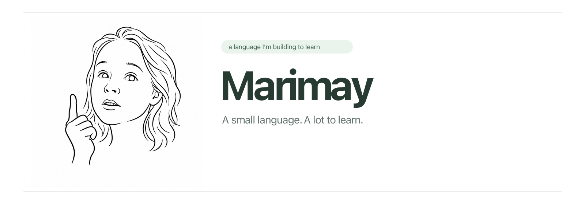

<strong>Open source. Personal. Built to learn and have fun.</strong>

# Marimay community files

The organization profile and shared contribution and security guidance for
[Marimay](https://github.com/marimay-lang), a personal open-source learning
project built for curiosity and fun. Original content is MIT licensed.

The public organization profile lives in [profile/README.md](profile/README.md).
